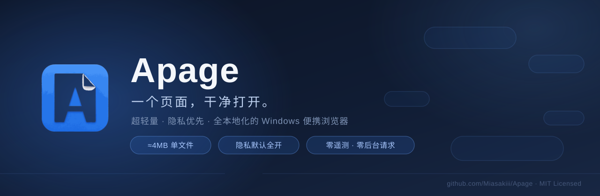

<div align="center">



[](https://github.com/Miasakiii/Apage/actions/workflows/ci.yml)
[](LICENSE)


**超轻量 · 隐私优先 · 全本地化的 Windows 便携浏览器**

</div>

---

## ✨ 为什么是 Apage

现代浏览器越来越重：十几个后台进程、强制登录、云同步、无处不在的推荐位。Apage 反其道而行——

| 特性 | 说明 |
|------|------|
| 🪶 **极致轻量** | 单文件 EXE 约 4MB，目标窗口可见 <1 秒；基于 .NET Framework 4.8（系统自带）+ WebView2（系统 Chromium 内核） |
| 💾 **Portable** | 数据跟程序走，U盘即插即用，双击就跑，不写注册表、不留安装残留 |
| 🛡️ **隐私默认全开** | DNT / Sec-GPC 头、WebRTC IP 防护、94,646 条 EasyList/EasyPrivacy 兼容离线规则快照，开箱即生效，无需任何配置 |
| 🔌 **零遥测 · 零后台请求** | 无统计、无崩溃上报、无云同步、无"检查更新"；全仓仅两条网络出口，由白名单与 CI 门禁双重锁死（见下节） |
| 🙅 **无需登录** | 不强制账号，不要求云同步，你的浏览数据永远只在你手里 |
| 🖼️ **壁纸新标签页** | 内置渐变壁纸 / 本地图片拖入即设；搜索、快捷方式与时钟一屏可达；本周拦截统计在工具栏隐私盾中查看 |
| 🔍 **顺手好用的日常能力** | 多标签（拖拽排序 / 休眠 / 会话恢复）、书签与历史（SQLite）、Chrome/Edge 书签导入、地址栏本地建议与 `!gh` `!w` `!yt` bangs 快捷搜索、Ctrl+F 页内查找、深色主题 |
| 🚫 **浏览器本身无广告** | 没有推广位、没有赞助主页、没有弹窗打扰 |

## 🔒 隐私承诺（以及边界）

所有隐私声明以**可复现验证**为准，不做无法兑现的承诺。

**我们做的：**

- **网络层拦截** — ABP 兼容规则引擎（子串索引，实测 24µs/URL）；内置离线规则快照加载前 SHA-256 校验；不可信规则拒收：超长规则、不支持的修饰符 fail-closed、正则 100ms 超时防 ReDoS
- **头部信号** — `DNT: 1` + `Sec-GPC: 1` 默认注入
- **WebRTC IP 泄露防护** — 内核级 `disable_non_proxied_udp`，支持按站点开关
- **数据全本地** — 书签/历史/下载落本地 SQLite（事务迁移、迁移前备份、损坏不删库）；设置/会话为原子写 JSON，全部保留在本机
- **按顶层站点防护覆盖** — 被误伤的内网/特殊站点可整页放行（含其加载的第三方资源），不必全局降级隐私等级；另支持便携站点允许清单（`allowlist.txt`）预置
- **零出站门禁** — 每次 CI 构建都以真实进程级探针验证：首启阶段零非白名单网络连接

**我们不做的（诚实口径）：**

- **不宣称能剥离第三方 Cookie** — 真机探针证实：在 `WebResourceRequested` 中删除 Cookie 后，WebView2 网络栈仍会重新附加。该能力已整体下架，**相关字段、开关与统计口径均已移除，不虚构拦截统计**；仅当 Runtime 未来提供可验证的平台入口时才会重启
- **无指纹防护** — WebGL / Canvas / WebAudio 参数在 WebView2 壳层不可干预；隐私能力止步于「网络层拦截 + 头部信号 + WebRTC IP 防护」
- **WebView2 Runtime 自身的诊断数据不受 Apage 控制**（微软文档明示其独立于 Windows 诊断设置）——「零遥测」承诺覆盖 Apage 自身代码，不覆盖 Runtime
- **无恶意软件/钓鱼黑名单** — SmartScreen 信誉检查已默认关闭，因为它会把导航 URL 整址上传微软，与「URL 不外传」定位冲突；代价是失去内核级风险提示，这一点我们不隐瞒

**全仓仅有的两条网络出口**（由红线脚本按文件白名单锁死 + 首启出站探针验证）：

1. 设置里**手动点击**「立即更新规则」— 逐跳 HTTPS、限时限大小、校验后原子替换、失败自动回滚并保留旧规则；不点击则运行时零联网
2. 四个内置搜索引擎的图标在本地无缓存时**各抓取一次** `favicon.ico` — 仅白名单主机、HTTPS、可在设置一键关闭；用户自己添加的站点永不联网补图

## 🚀 快速开始

**环境要求**：Windows 10/11 x64 + WebView2 Runtime（Win11 默认预装；未安装时 Apage 给出中文引导面板，**绝不静默联网下载**）。

> v0.1 正在收尾（代码签名、参考机启动终验、exFAT 与真机交互验收进行中），正式发布后会提供单文件下载。当前可从源码构建：

```powershell
# 环境：.NET 8 SDK（构建共享层）+ Visual Studio 2022（MSBuild + .NET FX 4.8 目标包）

git clone https://github.com/Miasakiii/Apage.git
cd Apage

build\build.ps1          # Release 构建整个解决方案（自动定位 VS MSBuild）
build\smoke.ps1          # 五信号冒烟：应用/窗口/WebView2/SQLite/隐私资产 + 零出站探针
build\package.ps1        # 正式单文件打包：体积门禁 + SHA-256 + 启动基准 + 许可包
```

产物：`artifacts\portable\Apage.Portable.exe`（唯一必需分发文件，运行时目录结构见下文）。

## 🏗️ 技术架构

```
Apage.Portable（唯一发布线）
.NET Framework 4.8 + WPF · 单文件 ≈4MB
WebView2 宿主 · WebMessage 异步桥 · 本地新标签页
│
├── Apage.Core（.NET Standard 2.0 共享层）
│   ├── Models：设置 / 会话 / 站点覆盖 / 周统计
│   ├── Services：AdBlock · Privacy · Rule Snapshot · PSL · Session · ScriptManager（元数据 / 匹配 / 注入构建）
│   └── Data：SQLite 仓储（书签 / 历史 / 下载）
│
└── 系统 Edge WebView2 Runtime（Chromium）
```

| 维度 | 选型 |
|------|------|
| 运行时 | .NET Framework 4.8（Win10/11 系统自带，真·免安装） |
| 单文件方案 | Fody/Costura 托管合并 + 原生库内嵌自解压引导 |
| UI | WPF（设计令牌驱动的浅/深双主题） |
| 引擎 | WebView2（系统自带 Chromium），每标签独立内核视图、共享 Environment |
| 通信 | WebMessage 异步桥（NTP/查找条等本地页面，带 Source 门控） |
| 存储 | SQLite（书签/历史/下载）+ 原子写 JSON（设置/会话/周统计） |
| 拦截 | 自研 ABP 兼容引擎：子串索引 + fail-closed 规则边界 + 正则超时 |
| 共享层 | Apage.Core 纯逻辑（无 Windows 依赖），489 项 xUnit 单测 |

## 📊 项目状态

**已完成（v0.1 功能面）：**

- 多标签浏览：拖拽排序、非活跃休眠、退出保存/启动恢复会话、隐私标签结构性排除
- 数据层：书签/历史/下载管理（SQLite 安全基座）、Chrome/Edge 书签 HTML 导入
- 浏览体验：智能地址栏（URL/搜索识别 + 本地建议 + bangs）、Ctrl+F 页内查找、深色主题、壁纸新标签页、站点图标本地缓存（零额外请求）
- 隐私与拦截：94,646 条离线规则快照、PSL 精确第三方判定、按站点防护覆盖、页级拦截计数 + 盾牌徽章、DNT/GPC、WebRTC IP 防护
- 工程化：单文件打包链、五信号冒烟、零出站探针、许可合规校验、启动基准，全部接入 CI 门禁

**收尾中（发布前）：**

- 代码签名（SignPath 开源签名计划）与签名后同产物复验；当前仅有本机自签名演练，尚无可信发布签名
- 参考机上的启动性能终验（目标：窗口可见 <1 秒）；该门禁由所有者暂缓，阈值未放宽，最终签名产物仍需复测
- exFAT 物理介质上的便携运行矩阵；本机无 exFAT 卷，自动故障矩阵中该项为跳过而非通过

**v0.1 之后规划：**

- 用户脚本管理器（Tampermonkey 兼容元数据 / GM_* API，一级差异化方向）：Phase 7a 最小内核已完成离线 Spike 5，验证 document-start 同步 GM 存储、权限门控、桥接令牌、响应头 CSP 与快照刷新（34/34 断言）；生产接入仍需 SQLite 持久化、写入 ACK/重试及管理 UI
- F12 开发者工具增强 + 反调试过滤（`debugger` 中和，仅调试辅助定位）
- 化妆规则（`##`）与完整 ABP 引擎、隐私标签、阅读模式、多窗口

## 💻 开发

<details>
<summary>环境要求与常用命令</summary>

- Windows 10/11（WebView2 Runtime 系统自带）
- .NET 8 SDK（构建共享层与测试，版本经 `global.json` 固定）
- Visual Studio 2022（MSBuild + .NET Framework 4.8 目标包）——构建主项目必需

```powershell
build\preflight.ps1      # 只读环境预检：确认本机可用的构建路线
build\build.ps1          # Restore + 构建整解（混合 sln 不支持 dotnet build，请使用本脚本）
dotnet test Apage.Core.Tests/Apage.Core.Tests.csproj   # 489 项 Core 单测
build\smoke.ps1          # 五信号冒烟 + 数据往返 + 布局探针 + 零出站探针
build\check-redlines.ps1 # 五条工程红线机械化检查（零遥测/通配符 csproj/隐私默认值等）
build\check-licenses.ps1 # MIT/MPL/CC 许可全文与隐私资产哈希校验
build\package.ps1        # 正式单文件打包 + 全部门禁验收 + SHA-256 + legal bundle
```

> `Apage.sln` 是「旧式 .NET FX 4.8 + SDK 风格」混合解决方案，`dotnet build Apage.sln` 会失败——这是已知约束，`build\build.ps1` 已自动处理 MSBuild 定位与 SDK 路径回退。

</details>

## 维护约定

- 独立验证项目位于 `spikes/`，清单与运行方式见 [spikes/README.md](spikes/README.md)；这些项目均不加入 `Apage.sln`，不参与生产 EXE 打包。
- `artifacts/` 为本地发布证据目录，不进入公开仓库。应保留单文件候选、哈希/manifest、启动 waiver、故障矩阵、最终 UI 走查、Spike 结果、许可包与干净候选备份。
- 旧 UI 走查、旧基准和临时诊断副本可按需清理；`.workbuddy/` 与上述发布证据不参与清理。

**运行时目录结构**（`data/` 等在运行时生成，数据跟程序走）：

```
Apage/
├── Apage.Portable.exe     # 唯一必需分发文件
├── data/
│   ├── settings.json      # 设置（原子写）
│   ├── session.json       # 会话保存/恢复
│   ├── privacy-stats.json # 周拦截统计（纯本地）
│   ├── site-shields.json  # 按顶层站点防护覆盖
│   ├── allowlist.txt      # 可选：便携站点允许清单
│   ├── apage.db           # 书签 / 历史 / 下载（SQLite）
│   ├── adblock/           # 用户自定义规则
│   ├── privacy/           # 手动更新的规则快照
│   ├── webui/             # 新标签页本地资产
│   └── logs/              # 本地滚动日志
├── wallpapers/            # 预留目录；当前壁纸存于 WebView2 localStorage
└── cache/                 # 仅纯便携模式；默认缓存在宿主机 %TEMP%\Apage\cache
```

## 🙏 致谢

- 架构轻量方案参考 [ZZZ 浏览器](https://github.com/zengjiangy/ZZZ)
- 「已知限制」的预期管理做法参考 Helium
- 拦截规则来自 [EasyList / EasyPrivacy](https://easylist.to/)（CC BY-SA 3.0）；第三方域名判定基于 [Public Suffix List](https://publicsuffix.org/)（MPL-2.0）

## 📄 许可证

Apage 源代码采用 **MIT**（见 [LICENSE](LICENSE)）。

随包隐私数据保持各自许可：Public Suffix List 为 **MPL-2.0**，EasyList/EasyPrivacy 过滤快照按 **CC BY-SA 3.0** 分发。完整归属与许可全文见 [THIRD-PARTY-NOTICES.txt](licenses/THIRD-PARTY-NOTICES.txt) 与 [licenses/](licenses/) 目录；每次打包还会生成独立的 `artifacts\legal\` 发布许可包。

---

<div align="center">

**一个页面，干净打开。**

</div>
